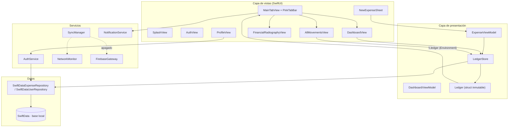
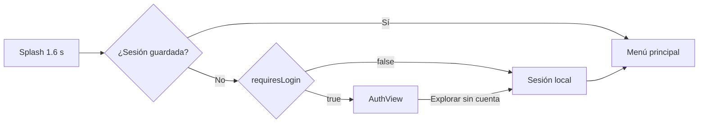
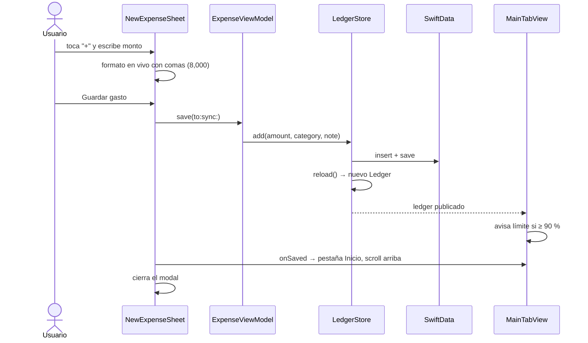
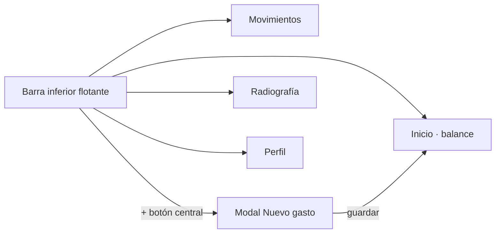

# Pink Money · Documento de arquitectura

App nativa de iOS para finanzas de estudiantes (gastos hormiga, presupuesto mensual y radiografía de consumo). Este documento describe el estado actual del proyecto: tecnologías, arquitectura, flujo, diseño y componentes.

- **Versión:** 1.0 (build 1)
- **Plataforma:** iOS 26+, iPhone y iPad (`Package.swift`, Swift Playgrounds `.swiftpm`)
- **Modo actual:** 100 % local. Firebase está construido pero apagado (`PinkTheme.cloudSyncEnabled = false`).
- **Idioma de la interfaz:** español (México). Moneda: MXN.

---

## 1. Tecnologías

| Área | Tecnología | Uso |
|---|---|---|
| Lenguaje | Swift 5.9 (modo Swift 5) | Todo el código |
| Interfaz | SwiftUI | Pantallas, componentes, animaciones |
| Persistencia | SwiftData (`@Model`, `ModelContainer`, `ModelContext`) | Base local en el iPhone: gastos y perfil |
| Gráficas | Swift Charts (`SectorMark`, `BarMark`) | Dona por categoría y barras por mes |
| Notificaciones | `UserNotifications` | "El Cerdo avisa del límite" al 90 % y 100 % |
| Red | `Network` (`NWPathMonitor`) | Detectar conexión (solo útil con la nube activa) |
| Seguridad | `Security` (Keychain), `CryptoKit` (SHA256 con sal) | Sesión y credenciales locales |
| Nube (apagada) | Firebase Auth y Firestore por REST con `URLSession` | Sin dependencias externas (no usa SPM) |
| Reglas de nube | `firestore.rules` | Cada usuario solo lee y escribe lo suyo |
| Reactividad | `ObservableObject`, `@Published`, `@EnvironmentObject`, `EnvironmentKey` | Estado compartido |
| Concurrencia | `async/await`, `@MainActor` | Servicios y almacén de datos |
| Háptica | `UIKit` (`UIImpactFeedbackGenerator`, `UINotificationFeedbackGenerator`) | Botones, guardado y borrado |

**No hay dependencias de terceros.** Todo es framework de Apple.

---

## 2. Arquitectura

Patrón **MVVM + Repository**, con una única fuente de verdad para los números (`Ledger`) y un almacén que la recalcula en cada escritura (`LedgerStore`).



### 2.1 Capas

**Modelos (`Models/`)**
- `Expense` (`@Model`): `id` (único), `amount`, `category`, `date`, `note`, `isSynced`.
- `UserProfile` (`@Model`): `id` (único), `email`, `monthlyBudget`, `sessionToken`, `displayName`, `school`.
- `ExpenseCategory`: `renta`, `servicios`, `despensa`, `transporte`, `facultad`, `ocio` (título, ícono SF Symbols y color).
- `ProfileSnapshot`: copia inmutable del perfil para las vistas.

**Persistencia (`Persistence/`)**
- `LocalDatabase.makeContainer()`: crea el contenedor SwiftData (`PinkMoney`, sin CloudKit). Si la base no abre, la aparta como respaldo (`.respaldo-<fecha>`) en lugar de borrarla.
- `ExpenseRepository` / `UserRepository` (protocolos) y sus implementaciones `SwiftData…`: insertar, leer, borrar, marcar sincronizado, actualizar presupuesto y datos del perfil.

**ViewModels (`ViewModels/`)**
- `Ledger`: fuente de verdad de los números. Calcula gasto del mes y del día, disponible, porcentaje, estado de límite (≥ 90 %), agrupación por día, rebanadas por categoría y todo el histórico (`HistoryPeriod`, `monthlyTotals`).
- `LedgerStore` (`@MainActor`): lee la base local, publica el `Ledger` y lo **recalcula en el momento** tras cada alta, baja o cambio de presupuesto. Es la razón por la que el contador se actualiza al instante.
- `ExpenseViewModel`: estado del formulario "Nuevo gasto". Guardar es síncrono y local.
- `DashboardViewModel`: textos y alertas de la pantalla de balance.

**Servicios (`Services/`)**
- `AuthService`: sesión local y de nube, perfil, presupuesto. Reutiliza el perfil local y conserva los gastos.
- `SyncManager`: cola de sincronización con Firestore (`isSynced`). Con la nube apagada no hace nada.
- `NotificationService`: avisos de límite al 90 % y 100 %, una vez por nivel y por mes.
- `NetworkMonitor`, `FirebaseGateway`, `FirebaseConfig`, `KeychainStore` (`SessionVault`), `PinkMoneyError`.

**Vistas (`Views/`) y diseño (`Design/`)**: ver secciones 4 y 5.

### 2.2 Inyección de dependencias

`PinkMoneyApp` crea todo una sola vez y lo inyecta:

```
LocalDatabase → ModelContainer
LedgerStore(container)
AuthService(container, gateway, network, ledger)
SyncManager(container, auth, network, gateway, ledger)
NotificationService, NetworkMonitor

SplashView
  .environmentObject(ledger / auth / network / notifications / sync)
  .preferredColorScheme(.dark)
.modelContainer(container)
```

`MainTabView` publica `store.ledger` por el entorno (`\.ledger`), así Inicio, Movimientos y Radiografía leen el mismo `Ledger` sin repetir filtros ni sumas.

### 2.3 Banderas del flujo (`PinkTheme`)

| Bandera | Valor | Efecto |
|---|---|---|
| `requiresLogin` | `false` | La app abre directo en el menú; el usuario navega libremente |
| `cloudSyncEnabled` | `false` | Sin Firebase, sin cola y sin avisos de red; todo vive en el iPhone |
| `defaultBudget` | `8,000` | Presupuesto inicial |

Para activar la nube: poner `cloudSyncEnabled = true` y llenar `API_KEY` y `PROJECT_ID` en `FirebaseConfig`.

---

## 3. Flujos

### 3.1 Arranque



### 3.2 Registrar un gasto



Reglas: monto mayor a 0 y hasta $1,000,000; nota recortada a 240 caracteres; no espera a ninguna red.

### 3.3 Borrar un gasto

Deslizar la fila a la izquierda y soltar **borra directo** (sin confirmación):
- Se borra si el arrastre llega al 40 % del ancho de la fila (mínimo 110 pt), o con un deslizamiento rápido tras 60 pt (`SwipeDeleteRule`).
- Si se suelta antes, la fila regresa. Si el borrado falla, la fila regresa y se muestra el error.
- Funciona en Inicio (componente `SwipeToDelete`) y en Movimientos (`.swipeActions` nativo).

### 3.4 Alerta de límite

`Ledger.isAtLimit` (≥ 90 %) muestra el banner "El Cerdo avisa del límite" en Inicio. `NotificationService` lanza la notificación local una vez al 90 % y otra al 100 %, por mes. Cambiar el presupuesto o borrar gastos recalcula todo.

### 3.5 Histórico (Radiografía)

- Selector **Mes / Año** y flechas para moverse de periodo (no pasa del periodo actual ni antes del primer gasto).
- Cada periodo muestra: total, número de movimientos, promedio (diario en mes, mensual en año), dona por categoría, mayor fuga y desglose.
- En **Año**: gráfica de barras por mes y lista "Mes por mes"; tocar un mes abre su detalle.

### 3.6 Navegación



- Las cuatro pestañas viven a la vez (conservan su scroll y estado).
- La barra flota encima del contenido y comparte su altura medida (`barClearance`) para que el scroll nunca quede tapado.
- La barra se oculta cuando aparece el teclado.

### 3.7 Perfil

Editable: nombre, escuela o facultad y correo (el correo solo en modo local). Presupuesto con campo con comas y ajustes ± $500. Cerrar sesión limpia la base local tras confirmar.

---

## 4. Pantallas

| Pantalla | Archivo | Qué hace |
|---|---|---|
| Splash | `SplashView` | Entrada animada con el Cerdo y degradado negro-vino |
| Acceso | `AuthView` | Login / registro y "Explorar sin cuenta" (solo si `requiresLogin`) |
| Menú principal | `MainTabView` | Páginas, barra inferior, modal de gasto y avisos de límite |
| Inicio | `DashboardView` | Saludo, tarjeta de presupuesto, alertas, "+ Registrar gasto", últimos movimientos con deslizar para borrar |
| Movimientos | `AllMovementsView` | Historial por día con filtro por categoría |
| Radiografía | `FinancialRadiographyView` | Histórico por mes y año, dona, barras, desglose |
| Perfil | `ProfileView` | Datos, presupuesto, estado de nube, cerrar sesión |
| Nuevo gasto | `NewExpenseSheet` | Monto, montos rápidos, categoría, nota (`.presentationDetents`) |

---

## 5. Sistema de diseño

La app usa **siempre el tema oscuro** (`.preferredColorScheme(.dark)`): negro con rosa oscuro y rosa brillante como acento. La paleta viene del storyboard técnico y del diagrama de flujo.

### 5.1 Paleta (`PinkPalette`)

Cada color es adaptativo (claro / oscuro); en producción se ve el oscuro.

| Token | Claro | Oscuro | Uso |
|---|---|---|---|
| `canvas` | `#FAF8F5` | `#0B0608` | Fondo de pantalla |
| `surface` | `#FFFFFF` | `#1B1116` | Tarjetas y filas |
| `surfaceMuted` | `#F2EFEA` | `#2A1920` | Campos, chips, botones suaves |
| `hairline` | `#E7E2DA` | `#3F2630` | Bordes |
| `ink` | `#1A201B` | `#FFF8F9` | Texto principal |
| `inkSoft` | `#596A5C` | `#EFD5DC` | Texto secundario |
| `inkFaint` | `#8E8E93` | `#C4A8B0` | Texto terciario, íconos inactivos |
| `forest` | `#1A201B` | `#5A1D33` | Tarjetas destacadas (vino en oscuro) |
| `forestSoft` | `#313C33` | `#7B2A47` | Acentos de tarjeta destacada |
| `onForest` | `#FAF8F5` | `#FAF8F5` | Texto sobre tarjeta destacada |
| `sage` | `#9AB2A0` | `#9AB2A0` | Estado tranquilo |
| `sageDeep` | `#596A5C` | `#A6BEA7` | Íconos y etiquetas verdes |
| `rose` | `#D8A7A0` | `#D8A7A0` | Rosa polvo de marca |
| `roseSoft` | `#F4E5E2` | `#3A1D27` | Fondo de aviso rosa |
| `roseDeep` | `#B87C75` | `#E3B5AF` | Rosa de énfasis |
| `wine` | `#5C1A2E` | `#E6B9C2` | Vino del diagrama |
| `accent` | `#9C4A5A` | `#F2A7BA` | Acento (pestaña activa, enlaces, barras) |
| `buttonFill` | `#1A201B` | `#F2A7BA` | Botón primario |
| `onButton` | `#FAF8F5` | `#1E0A12` | Texto del botón primario |
| `danger` | `#FF3B30` | `#FF6A60` | Borrar, errores |
| `warning` | `#C9964A` | `#E0B068` | Advertencias |
| `success` | `#4F8A63` | `#7DBE92` | Confirmaciones |

**Fondo de pantalla (`PinkScreen`):** negro `#0B0608` con dos resplandores de degradado radial: rosa `#F2A7BA` (30 %) arriba a la derecha y vino `#8E2A55` (55 %) abajo a la izquierda. **Splash:** degradado `#3A1424` → `#0B0608`.

**Colores de categoría**

| Categoría | Color | Ícono |
|---|---|---|
| Renta | `#9C4A5A` | `house.fill` |
| Servicios | `#C9964A` | `bolt.fill` |
| Despensa | `#6F9477` | `cart.fill` |
| Transporte | `#5B7C99` | `bus.fill` |
| Facultad | `#8A7BA8` | `graduationcap.fill` |
| Ocio | `#D8A7A0` | `sparkles` |

### 5.2 Tokens (`PinkTheme`)

| Token | Valor |
|---|---|
| Radios | tarjeta 26 · control 18 · fila 20 · chip 14 |
| Espacios | pantalla 20 · sección 22 · elemento 12 |
| Monto grande | SF Rounded 44 bold |
| Monto | SF Rounded (estilo dinámico) bold |
| Título | SF Rounded (estilo dinámico) bold |
| Eyebrow | SF Rounded 11 bold, mayúsculas, con tracking |

### 5.3 Formato de dinero (`MoneyFormat`)

- Salida en `es_MX`: `$8,000.00`, `$8,000` (corto), porcentaje sin decimales.
- Campos editables con **comas en los millares en vivo** (`8000` → `8,000`), máximo 2 decimales y 7 dígitos enteros.
- Lectura tolerante: acepta `85`, `85.5`, `85,5`, `8,000`, `1,234.50` y `1.234,50`. Rechaza cero, negativos y más de $1,000,000.

### 5.4 Modificadores y estilos

- `pinkSurface(_:radius:elevated:)`: fondo, borde y sombra de las tarjetas. Estilos `surface`, `muted`, `forest` y `rose`.
- `Text.pinkEyebrow()`: etiqueta pequeña en mayúsculas.
- `groupedMoney($text)`: comas en vivo en campos de dinero.
- `newExpenseSheet(isPresented:onSaved:)`: presenta el modal de gasto con `.presentationDetents([.medium, .large])`.
- Botones: `PinkPrimaryButtonStyle`, `PinkSoftButtonStyle`.

### 5.5 Catálogo de componentes

| Componente | Archivo | Descripción |
|---|---|---|
| `PinkScreen` | `Views/PinkComponents.swift` | Fondo negro con resplandores |
| `PinkScrollView` | `Views/PinkComponents.swift` | Scroll estándar: márgenes, espacio para la barra, cierra teclado, volver arriba |
| `PinkCard` | `Views/PinkComponents.swift` | Tarjeta con estilo |
| `PrimaryDarkButton`, `PinkSoftButton`, `PinkPillButton` | `Views/PinkComponents.swift` | Botón primario, suave y píldora |
| `PinkTabBar` | `Design/Components/PinkTabBar.swift` | Barra inferior flotante con íconos y botón "+" de 48 pt |
| `SwipeToDelete` | `Design/Components/SwipeToDelete.swift` | Deslizar para borrar dentro de un `ScrollView` |
| `HeroBalanceCard` | `Design/Components/HeroBalanceCard.swift` | Tarjeta del presupuesto: disponible, gastado, hoy |
| `BudgetMeter`, `PinkProgressBar` | `Design/Components/BudgetMeter.swift` | Medidor y barra con tono por nivel |
| `MovementRow` | `Design/Components/MovementRow.swift` | Fila de gasto: categoría, nota, fecha, monto |
| `CategoryBadge`, `CategoryPill`, `PinkFilterChip`, `CategoryFilterBar` | `Design/Components/CategoryComponents.swift` | Categorías y filtros |
| `CategoryDonutCard`, `TopLeakCard`, `CategoryBreakdownRow` | `Design/Components/RadiographyComponents.swift` | Dona, mayor fuga y desglose |
| `PeriodNavigator`, `PeriodSummaryCard`, `MonthlyBarsCard`, `MonthSummaryRow` | `Design/Components/RadiographyComponents.swift` | Histórico por mes y año |
| `PinkField` | `Design/Components/PinkField.swift` | Campo con título e ícono |
| `PinkSectionHeader`, `PinkScreenHeader` | `Design/Components/PinkSectionHeader.swift` | Encabezados |
| `PinkIconRow` | `Design/Components/PinkIconRow.swift` | Fila de acción con ícono |
| `StatusChip`, `PinkBadge`, `PinkAlertBanner`, `EmptyStateView` | `Design/Components/PinkStatus.swift` | Estados, insignias, alerta del Cerdo, vacíos |
| `CerdoMascot` | `Design/CerdoMascot.swift` | Mascota (cerdo con lentes) dibujada en SwiftUI |

---

## 6. Datos y persistencia

- **Dónde:** base SwiftData `PinkMoney` en el almacenamiento de la app (no sincroniza con iCloud).
- **Qué se guarda:** gastos, perfil (nombre, escuela, correo, presupuesto) y, con la nube activa, el estado `isSynced`.
- **Migración:** los campos nuevos del perfil tienen valor por defecto, así que las bases anteriores se actualizan sin perder datos.
- **Cierre de sesión:** borra gastos y perfil locales tras confirmar y abre una sesión local nueva.
- **Seguridad:** sesión y credenciales en Keychain; contraseñas locales con SHA256 y sal.

### Esquema de nube (apagado, listo para activar)

```
users/{uid}                    → email, monthlyBudget
users/{uid}/expenses/{id}      → amount, category, date, note, isSynced
```

Reglas (`firestore.rules`): solo el dueño (`request.auth.uid == userId`) puede leer y escribir su usuario y sus gastos.

Flujo de sincronización (cuando se active): con red y sesión de nube, `SyncManager` sube el perfil, empuja los gastos con `isSynced == false`, los marca como sincronizados y baja los remotos. Sin red, los gastos esperan en la cola local.

---

## 7. Estructura de carpetas

```
pinkmoney.swiftpm/
├── Package.swift
├── PinkMoneyApp.swift
├── firestore.rules
├── Docs/ARQUITECTURA.md
├── Models/          Expense, UserProfile, ExpenseCategory
├── Persistence/     LocalDatabase, ExpenseRepository, UserProfileRepository
├── Services/        AuthService, SyncManager, NotificationService, NetworkMonitor,
│                    FirebaseGateway, FirebaseConfig, KeychainStore, PinkMoneyError
├── ViewModels/      Ledger, Ledger+Expense, LedgerStore, DashboardViewModel, ExpenseViewModel
├── Views/           Splash, Auth, MainTab, Dashboard, AllMovements,
│                    FinancialRadiography, Profile, NewExpenseSheet, PinkComponents
└── Design/          PinkPalette, PinkTheme, Modifiers, MoneyFormat, SwipeDeleteRule,
    └── Components/  CerdoMascot, PinkTabBar, SwipeToDelete, MovementRow, …
```

---

## 8. Verificación

Se validó con pruebas de lógica sobre una base SwiftData real (en memoria y en disco) y con compilación en Mac Catalyst:

- Guardar, recalcular el contador y borrar; los datos sobreviven a cerrar y reabrir la base.
- Histórico: totales por mes, año completo, año anterior y límites de navegación.
- Formato en vivo de dinero y lectura de montos.
- Regla de deslizar para borrar (umbral, deslizamiento rápido, dirección y toques).
- Perfil editable y conservado.

**Límite de la verificación:** no se pudo ejecutar en simulador de iOS, así que los gestos, animaciones y el aspecto visual deben revisarse en el dispositivo o en la vista previa de Swift Playgrounds.

---

## 9. Pendiente y siguientes pasos

1. **Backend:** crear el proyecto de Firebase, llenar `API_KEY` y `PROJECT_ID`, publicar `firestore.rules` y activar `cloudSyncEnabled`.
2. **Probar en dispositivo:** gestos (deslizar para borrar), barra inferior, scroll y notificaciones locales.
3. **Cuentas en la nube:** reactivar `requiresLogin` cuando exista el backend.
4. **Ideas:** deshacer un borrado, filtro por mes en Movimientos, exportar a CSV, modo claro opcional.
